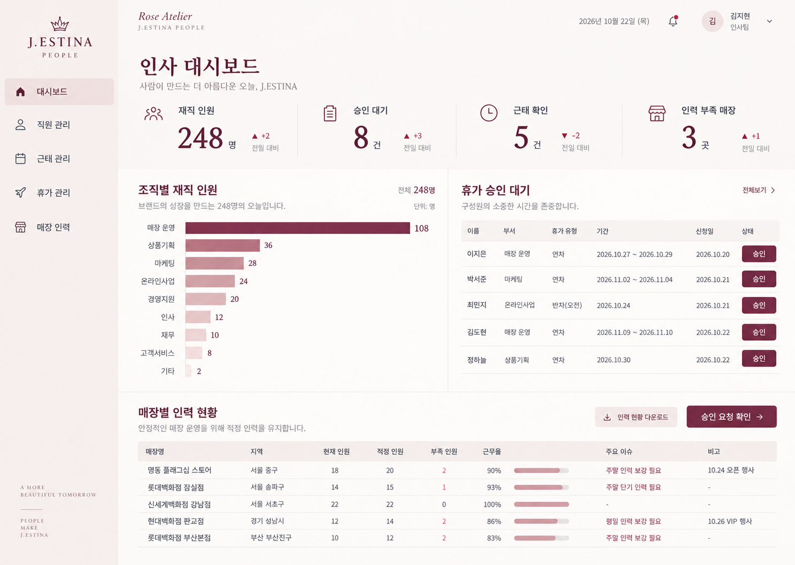
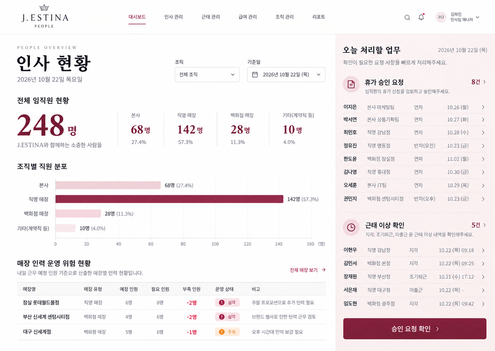
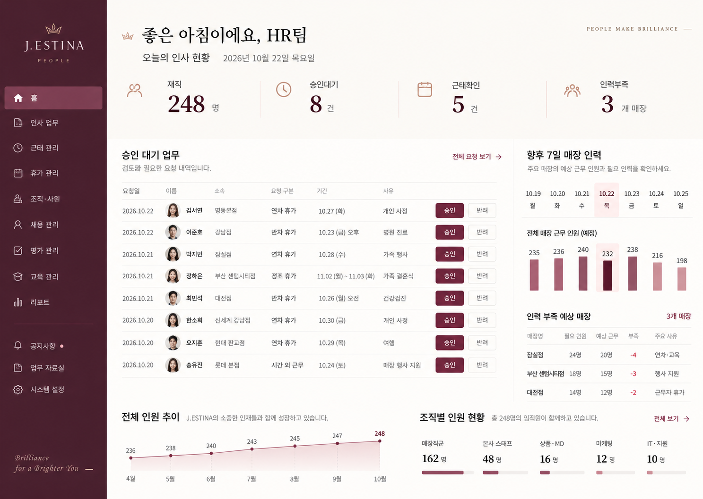

# 제이에스티나 HR 대시보드 디자인 시안

PRD를 바탕으로 만든 초기 디자인 시안입니다. 공식 브랜드 가이드가 아닌 제안 디자인이며, 모든 인명과 수치는 가상 데이터입니다. 생성형 이미지에 포함된 문구와 기능은 구현 시 PRD 기준으로 정리합니다.

## 시안 1 — 아이보리·로즈

밝은 사이드바와 버건디 포인트. 조직별 인원, 휴가 승인, 매장 인력 현황을 균형 있게 배치합니다.

## 시안 2 — 화이트·버건디

상단 내비게이션을 사용하고, 인력 현황과 오른쪽 업무 패널을 분리합니다.

## 시안 3 — 딥 버건디

진한 사이드바를 사용하고, 승인 업무와 향후 매장 인력 현황을 중심에 배치합니다.

추천 방향은 시안 1입니다. 브랜드 분위기와 일상적인 HR 업무 가독성을 균형 있게 가져갈 수 있습니다.
